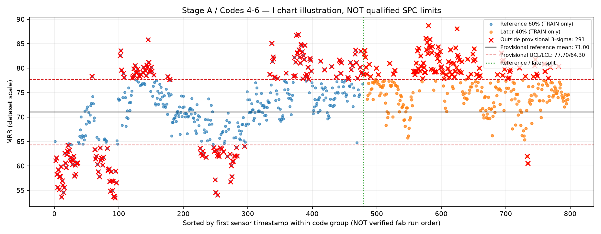
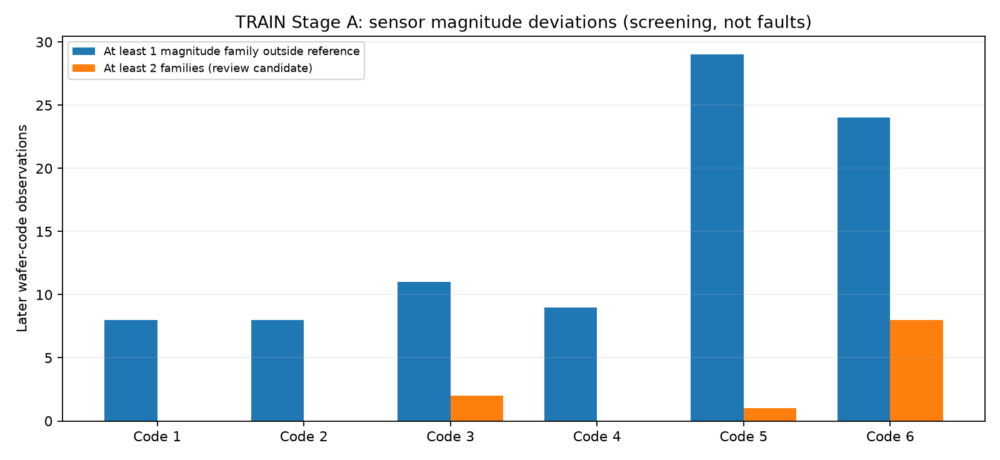
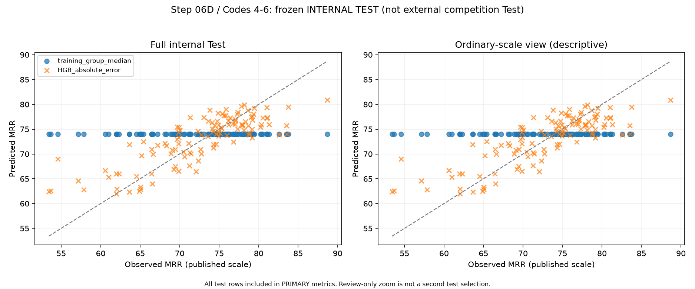
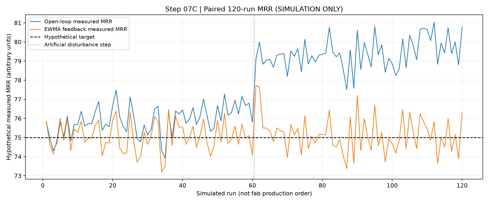

# 半導體 CMP 製程品質監控與異常分析

以公開的 **PHM Society 2016 CMP Data Challenge** 資料為基礎，練習從機台感測訊號與晶圓品質量測中辨識製程差異、建立統計監控、整理異常回查紀錄，並預測材料去除率（MRR）。此外，專案以**獨立設計的人工製程模擬**示範 Run-to-Run（R2R）回授控制。

這是一個研究與學習作品，**不是** Micron 或任何晶圓廠已部署的製程控制系統。

## 專案想解決的問題

- 同樣標記為 Stage A 的晶圓，為什麼 MRR 明顯分成不同群體？
- 這些資料能不能直接拿來建立 SPC 管制圖？哪些前提尚未符合？
- 能不能從壓力、研磨液流量和旋轉等感測訊號，找出需要人工回查的紀錄？
- 製程結束、正式 MRR 量測前，感測資料能否提供有用的品質預測？
- 在**人工模擬**的持續製程漂移下，EWMA 回授控制比固定設定值有什麼差異與代價？

## 使用的資料與範圍

來源：**PHM Society 2016 Data Challenge — CMP**。資料取得說明見下方「執行方式」。本專案使用者實際取得的資料來自[第三方整理倉庫](https://github.com/akangel0307/PHM-Data-Challenge)；[PHM Society](https://phmsociety.org/)為賽事主辦組織。原始資料未包含在本儲存庫，下載及再利用時須自行確認來源與授權條件。

| 資料範圍 | 整理結果 |
|---|---:|
| 原始感測紀錄（Training／Test／Validation 合計） | 973,154 筆 |
| 衍生分析感測紀錄（僅排除完全重複列） | 970,803 筆 |
| 晶圓－製程階段品質紀錄 | 2,829 筆 |
| 進一步分析的原始 Training／Stage A | 1,166 筆晶圓－階段紀錄 |

本專案的 **SPC、FDC 與虛擬量測研究主要使用原始 Training 的 Stage A**。原始資料中的 `MACHINE_DATA` 是匿名代碼，不能直接解讀為已確認的實體設備、配方或工廠產線。部分時間戳具有重疊或順序限制，不能直接當成經驗證的 Run-to-Run 製造順序。

## 主要分析結果

### 1. SPC｜統計製程監控

Stage A 的 MRR 分布可依感測資料中的匿名代碼分為 Codes 1–3 與 Codes 4–6 兩群，兩群典型 MRR 水準明顯不同。因此先分組檢查，再研究管制圖，而不是直接用所有晶圓建立一組界限。

在探索性的後段 Training 監控資料中，傳統 I Chart 分別標記 **31／146**、**113／319** 筆超界；AR(1) 殘差方法則標記 **0／146**、**4／319** 筆。這是兩種監控問題的比較，**不能解讀成 AR(1) 的故障偵測準確率比較高**，也不能把示範超界當成不良品。

### 2. FDC｜感測偏差與回查

依匿名代碼建立探索性的感測訊號參考範圍後，從 Stage A Training 的後段資料篩出 **11 片待查晶圓**，涉及 **27 筆感測數值偏離紀錄**。候選晶圓的 MRR 均未超出各自代碼組的描述性 Q05～Q95 參考區間。

這代表「感測訊號罕見」不一定伴隨明顯的最終 MRR 偏移。由於缺少已確認的設備故障類型標籤及廠內工程規格，本專案只提出**人工回查清單**，不宣稱完成故障分類或根因驗證。

### 3. Virtual Metrology｜虛擬量測

使用**整段製程完成後**萃取的感測特徵，預測正式量測前的 MRR。兩組匿名代碼各自使用 66 個固定感測特徵，將中位數基準與 HGB（HistGradientBoostingRegressor）比較，並在原始 Training 內保留一次性的內部 Test。

| 內部 Test 分組 | 晶圓數 | 基準 MAE | HGB MAE | HGB RMSE | HGB R² |
|---|---:|---:|---:|---:|---:|
| Codes 1–3 | 55 | 3.076 | 2.315 | 3.089 | 0.315 |
| Codes 4–6 | 119 | 5.162 | 3.002 | 3.875 | 0.661 |

Codes 1–3 與 Codes 4–6 的 MAE 分別較中位數基準下降約 **24.7%** 與 **41.8%**。這些是**從 PHM 原始 Training 再切分的內部 Test**，不是官方競賽外部 Test。原始資料曾出現 MRR 大於 1,000 的待查極端值；上述 Test 未包含這類紀錄，因此**不能據此宣稱模型已能處理極端製程情況**。

### 4. R2R｜獨立的人工模擬

由於公開資料不含可核實的「實際調機 → 下一輪加工 → 量測回授」完整紀錄，此段**不使用 PHM 感測資料冒充控制實驗**。我建立了 120 輪假設加工，讓無控制與 EWMA 控制使用相同的人工漂移與雜訊，控制器只能讀取**上一輪完成後**的 MRR。

| 模擬指標 | 固定設定值 | EWMA 回授 |
|---|---:|---:|
| 與假設目標 MRR=75 的 MAE | 2.715 | 0.689 |
| RMSE | 3.282 | 0.871 |
| 最後 30 輪平均偏差 | +4.634 | +0.084 |
| 實際設定值調整次數 | 0 | 116 |

模擬 MAE 下降約 **74.6%**，同時需要 **116 次設定值調整**。這不是 PHM 或 Micron 實際的良率、MRR 或製程改善成效。


## 專案圖表精選

下面是已完成分析的**實際圖表**，數值來自先前固定的研究結果；不代表正式晶圓廠的製程監控或良率改善。完整統計限制請參閱各段說明。

| SPC：探索性管制圖 | FDC：待查訊號候選 |
|---|---|
|  |  |

| VM：內部 Test | R2R：獨立模擬 |
|---|---|
|  |  |

## 線上展示與本機完整分析

本儲存庫保留兩種展示入口：

- **`streamlit_app.py`（可公開部署）**：使用經核對的彙總指標、自製分析圖片，以及 120 輪**純人工模擬**的輕量資料；沒有公開 PHM 原始感測 CSV、逐片特徵、逐片品質標籤、模型檔或私密設定。SPC／FDC／VM 為成果展示，不能在網上重新執行完整資料分析。
- **`dashboard.py`（本機詳細版）**：使用本機生成的 `outputs/`，提供更多逐片回查資訊；因公開 repo 排除了 `outputs/`，**直接把它指定為 Cloud 入口會找不到檔案**。

公開展示版和本機詳細版採用**同一份已核對的彙總結果**，但功能深度不同。公開版不是線上製程控制，也不會上傳／計算真實晶圓資料。

### 部署 Streamlit Community Cloud

1. 將 `streamlit_app.py`、`public_data/`、`docs/figures/`、更新的 `requirements.txt` 推送到此 GitHub Repository 的 `main` 分支。
2. 到 [Streamlit Community Cloud](https://share.streamlit.io/)，使用 GitHub 帳號登入，選擇 **Create app**。
3. Repository 選 `momo840505/cmp-process-quality-monitoring`，Branch 選 `main`，**Main file path 選 `streamlit_app.py`**，再按 Deploy。
4. 待網站成功啟動，將真正產生的 `*.streamlit.app` 網址補在此 README。**目前不預先宣稱已部署完成或編造網址。**

本機預先驗證公開版：

```powershell
.\.venv\Scripts\python.exe -m unittest discover -s tests -p "test_public_deployment.py" -v
.\.venv\Scripts\python.exe -m streamlit run .\streamlit_app.py
```

詳細注意事項：[公開部署指南](docs/cloud_deployment_guide.md)。

## 技術與專案架構

- **資料處理：** Python、pandas、NumPy；原始檔案盤點、去重與資料品質稽核。
- **SPC／FDC：** Matplotlib、描述統計、I Chart、AR(1)、按代碼的感測參考區間、OCAP 人工回查表。
- **品質預測：** scikit-learn、HGB、MAE／RMSE／R²、交叉驗證與固定的內部 Test。
- **R2R 示範：** EWMA、單輪延遲回授、設定值範圍／調整幅度約束、相同漂移和雜訊的配對模擬。
- **展示及驗證：** Streamlit、Plotly、`unittest`、整合稽核報告。

```text
CMP-Process-QE/
├── README.md
├── .gitignore
├── requirements.txt
├── requirements_dashboard.txt
├── dashboard.py             # 本機詳細分析版
├── streamlit_app.py          # GitHub 可部署的公開彙總展示版
├── public_data/              # 可發布的彙總指標 + 獨立模擬
├── src/                      # 01～08B 分析、模型、模擬與驗證程式
├── tests/                    # 單元測試及資料驗收
├── docs/                     # 學習筆記、部署指引與精選結果圖片
└── outputs/                  # 本機執行結果，不提交 Git
    ├── audit/
    ├── processed/
    ├── analysis/
    ├── models/
    └── simulation/
```

## 在 Windows PowerShell 重建

已測試的開發環境使用 **Python 3.11**。以下以**新的專案資料夾、尚未產生任何 outputs** 為前提；若你已在本機完成 06D 與 07C，**請保留已凍結的成果，不要為了啟動 Dashboard 重跑最終 Test 或 R2R 比較**。

### 1. 準備環境

```powershell
cd "$HOME\Desktop\CMP-Process-QE"
python -m venv .venv
.\.venv\Scripts\python.exe -m pip install -r .\requirements.txt
.\.venv\Scripts\python.exe -m pip install -r .\requirements_dashboard.txt
```

> 已更新 `requirements.txt`，納入資料分析、機器學習及 Streamlit/Plotly 依賴。原本的 `requirements_dashboard.txt` 仍可作為單獨安裝展示介面的補充清單。套件使用版本範圍，未提供完全鎖版檔，因此不同版本仍可能有細微差異。

### 2. 取得資料

原始 PHM 網站部分歷史下載連結可能失效。本專案實際使用過的[第三方資料整理倉庫](https://github.com/akangel0307/PHM-Data-Challenge)可作為查找來源的線索，下載前請確認檔案結構及資料使用權限。資料請放在專案以外的資料夾，以下指令使用先前驗收過的結構：

```text
Desktop/PHM-Data-Challenge/data/2016 PHM Data Challenge/
```

### 3. 依序建立分析資料

在專案根目錄執行。前兩個步驟需要明確指定原始 PHM 資料路徑：

```powershell
$source = "$HOME\Desktop\PHM-Data-Challenge\data\2016 PHM Data Challenge"
$py = ".\.venv\Scripts\python.exe"

& $py .\src\01_data_inventory.py --source $source
& $py .\src\02_data_quality_diagnostics.py --source $source
& $py .\src\02b_build_analysis_tables.py --source $source

& $py .\src\03a_mrr_eda.py
& $py .\src\03b_investigate_stageA_modes.py
& $py .\src\03c_phase1_stability_check.py
& $py .\src\03d_timestamp_and_group_integrity.py

& $py .\src\04a_provisional_spc_i_chart.py
& $py .\src\04b_ar1_residual_monitor.py

& $py .\src\05a_sensor_signal_profile.py
& $py .\src\05b_reference_sensor_activity.py
& $py .\src\05c_sensor_magnitude_screen.py
& $py .\src\05d_link_sensor_flags_to_quality.py
& $py .\src\05e_ocap_candidate_review.py

& $py .\src\06a_build_vm_features.py
& $py .\src\06b_vm_baseline_models.py
& $py .\src\06c_train_only_robustness.py
```

**只有在上述資料切分、模型方法和固定參數確認後**，才進行內部 Test。請只進行一次最終評估：

```powershell
& $py .\src\06d_final_internal_test.py --preflight
& $py .\src\06d_final_internal_test.py
```

R2R 為與 PHM 分開的模擬；先建立固定設定值情境，固定控制器後，再比較閉迴路：

```powershell
& $py .\src\07a_simulate_open_loop.py
& $py .\src\07b_design_r2r_controller.py
& $py .\src\07c_compare_closed_loop.py --preflight
& $py .\src\07c_compare_closed_loop.py
```

**06D、07C 都有正式完成標記；不應反覆執行以挑選偏好的分數。** 若要核對既有輸出，請執行只讀的資料驗證與整合稽核：

```powershell
& $py -m unittest discover -s tests -p "test_*.py" -v
& $py .\src\08b_integrated_audit.py
```

### 4. 啟動 Dashboard

```powershell
.\.venv\Scripts\python.exe -m streamlit run .\dashboard.py
```

通常可於 `http://localhost:8501` 開啟。Dashboard 只讀取先前建立的 CSV／JSON，不會重新訓練模型。**此儲存庫不附帶 `outputs/`，因此全新下載程式碼後，必須先完成資料準備及必要分析，Dashboard 才有內容。**

## 使用限制與資料說明

1. PHM 資料為公開研究資料；本專案尚未核實原始資料和第三方鏡像的完整再散布授權，因此**不將原始資料、逐片衍生 CSV 或模型檔案公開提交**。
2. 研究中的匿名代碼沒有足夠資訊對應到真實設備配方；`MRR > 1000` 是人工回查標記，**不是工廠品質規格**。
3. SPC 管制圖與 FDC 門檻皆為探索性研究，不代表已核准製程界限、已證實故障、設備安全性或產品良率。
4. 品質預測使用整段製程訊號；能展示的是**製程完成、正式量測前**的預測，不是加工當下的即時預警。
5. R2R 的流程和成績來自獨立人工模擬，不能與 PHM 量測成績合併解讀。

更多檔案公開與 Git 操作注意事項見 [`docs/08c_publication_guide.md`](docs/08c_publication_guide.md)。
